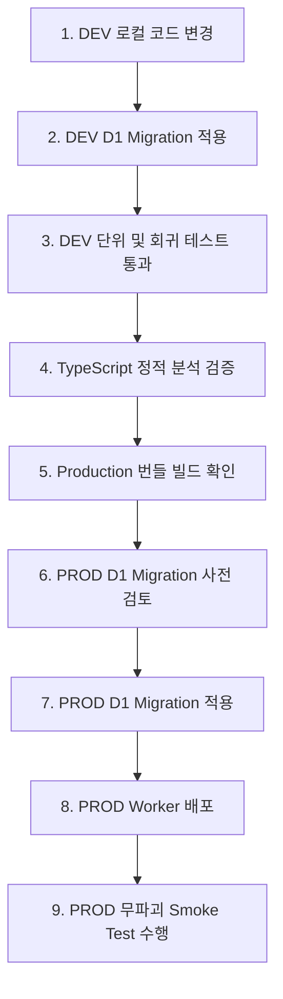

# HR 근태관리 시스템 운영 매뉴얼 (Version 1.0 Release Candidate Operations Guide)

본 문서는 HR 근태관리 시스템(Version 1.0)을 실제 회사 환경에서 안전하고 지속 가능하게 운영하기 위한 표준 기술 및 운영 지침서입니다.
개발자뿐만 아니라 경영지원 담당자 및 시스템 관리자가 일상 업무를 원활히 처리할 수 있도록 표준 절차와 일일/월간 점검표, 안전 수칙을 기술합니다.

---

## 1. 시스템 아키텍처 및 구성

- **프레임워크**: Next.js (Vinext React Server Component / Client)
- **배포 런타임**: Cloudflare Workers (Node.js 호환성 플래그 적용)
- **데이터베이스**: Cloudflare D1 (분산 SQLite)
- **ORM / 스키마 관리**: Drizzle ORM + D1 SQL 마이그레이션
- **인증 / 세션**: PBKDF2-HMAC-SHA256 (100,000회 반복), HttpOnly / Secure / SameSite=Lax 쿠키 세션

---

## 2. DEV 및 PROD 환경 구조 및 D1 분리

개발 환경(DEV)과 운영 환경(PROD)은 논리적/물리적으로 완벽히 분리되어 있으며, **절대로 동일한 D1 Database ID를 공유하지 않습니다.**

| 구분 | 개발 환경 (DEVELOPMENT) | 운영 환경 (PRODUCTION) |
| :--- | :--- | :--- |
| **Worker 이름** | `hr-attendance-app` (또는 local dev) | `hr-attendance-app-prod` |
| **D1 Database 이름** | `hr-attendance-dev` | `hr-attendance-prod` |
| **D1 Binding 명칭** | `env.DB` | `env.DB` |
| **UI 환경 뱃지** | 관리자 상단에 `DEVELOPMENT` 노출 | 시스템 관리 화면에서만 `PRODUCTION` 확인 |
| **시드(Seed) 허용** | 가상 테스트 직원 시드 허용 (`EMP001~005`) | **원천 차단 (HTTP 403 영구 금지)** |
| **직원 데이터 성격** | 가상 익명 데이터 (김관리, 이직원 등) | **실제 임직원 운영 데이터** |

---

## 3. 표준 배포 순서 (Safe Deployment Workflow)

운영 배포는 반드시 아래의 단계적 절차를 준수하며, 단계를 건너뛰지 않습니다:



1. **DEV 변경 및 검증**: 로컬 및 DEV 환경에서 신규 로직 반영.
2. **TypeScript 검사**: `node ./node_modules/typescript/bin/tsc --noEmit` 실행하여 0 Error 확인.
3. **Production Build 검사**: `node ./node_modules/vinext/dist/cli.js build` 실행하여 클라이언트/서버 청크 빌드 성공 확인.
4. **회귀 테스트**: `node scripts/test-phase10.mjs` 및 기존 테스트 스크립트 실행.
5. **PROD Migration 사전 검토**: 파괴적 구문(DROP TABLE, DROP COLUMN 등) 유무 점검.
6. **PROD 배포**: `npx wrangler deploy --env production`
7. **PROD Smoke Test**: 파괴적 작업 없이 로그인, 대시보드 조회, 리포트 조회, 감사로그 정상 출력 확인.

---

## 4. 데이터베이스 마이그레이션 정책

- **순차적 마이그레이션**: `0000`부터 `0007`까지 확정된 마이그레이션 파일은 절대 사후 수정하지 않습니다. 신규 변경은 새로운 마이그레이션 번호로 작성합니다.
- **파괴적 마이그레이션 금지**:
  - `DROP TABLE`, `DROP COLUMN`, `DELETE FROM` 일괄 삭제 자동 실행 금지.
  - 신규 컬럼은 `ADD COLUMN ... DEFAULT ...` 형태로 무중단 추가.
- **마이그레이션 적용 명령**:
  - DEV 환경: `npx wrangler d1 migrations apply hr-attendance-dev --local`
  - PROD 환경: `npx wrangler d1 migrations apply hr-attendance-prod --remote`

---

## 5. D1 Time Travel 및 시점 복구 (Point-in-Time Recovery)

Cloudflare D1은 북마크 기반의 **Time Travel 시점 복구(최대 7일)**를 기본 제공합니다.
관리자 Web UI에는 오작동 방지를 위해 [DB 복구] 버튼을 의도적으로 두지 않으며, 반드시 기술 운영자가 CLI를 통해 수행합니다.

### 복구 절차:
1. **신규 요청 일시 중단**: 추가적인 데이터 오염을 방지하기 위해 배포 또는 쓰기 작업을 중단합니다.
2. **사고 시점 확인**: 감사로그(`/admin/audit-logs`) 또는 시스템 오류 로그를 참조하여 사고 직전의 정상 시각(UTC)을 특정합니다.
3. **Time Travel 명령 실행**:
   ```bash
   # 예: 2026-09-27 08:00:00 시점으로 롤백 복구
   npx wrangler d1 time-travel restore hr-attendance-prod --timestamp="2026-09-27T08:00:00Z"
   ```
4. **정합성 검증**: `/admin/settings`의 [데이터 정합성 정밀 점검]을 실행하여 복구 후 데이터 무결성을 검증합니다.

---

## 6. 정기 수동 백업 및 SQL Dump 가이드

Time Travel 외에 월말 결산 전이나 대규모 변경 전 정기 SQL Dump를 권장합니다.

```bash
# 운영 D1 백업 SQL 내보내기
npx wrangler d1 export hr-attendance-prod --output="./backups/prod-backup-$(date +%Y%m%d).sql"
```

> **주의**: 백업 SQL 파일에는 임직원의 개인정보와 근태기록이 포함되므로, 절대 GitHub 등 공개 원격 저장소에 커밋하지 않습니다. (`.gitignore`에 `*.sql.bak`, `backups/` 등록 완료)

---

## 7. 비상 관리자 계정 복구 절차

운영 관리자(ADMIN)의 비밀번호 분실 또는 계정 잠금 발생 시, 백도어나 하드코딩 마스터 패스워드를 사용하지 않고 안전하게 복구합니다:

1. Cloudflare Workers 콘솔 또는 D1 명령어를 통해 관리자 계정 ID를 확인합니다.
2. 로컬 스크립트를 통해 새로운 안전한 솔트와 PBKDF2 해시를 생성합니다.
3. D1 `user_accounts` 테이블의 해시를 직접 업데이트합니다:
   ```sql
   UPDATE user_accounts 
   SET password_hash = '<신규해시>', password_salt = '<신규솔트>', updated_at = CURRENT_TIMESTAMP
   WHERE employee_id = (SELECT id FROM employees WHERE employee_number = 'EMP001');
   ```
4. 관리자 로그인 성공 후 임시 비밀번호를 즉시 변경하도록 안내합니다.

---

## 8. Excel 근태 일괄 등록 운영 주의사항

1. **미리보기(Preview) 필수**: 업로드 파일은 사전에 검증 결과를 화면에서 확인한 후, 관리자가 [DB 반영(Commit)]을 클릭해야만 실제 DB에 기록됩니다.
2. **충돌 처리 규칙**:
   - `KEEP_EXISTING` (기존 유지 권장): WEB 태깅이나 관리자 수기 보정 이력이 있을 경우 기존 기록 우선 보호.
   - `OVERWRITE_EXCEL`: 외부 지문인식기 등 원천 장비 데이터로 덮어쓰기가 필요할 때만 선별 적용.
3. **파일 제한**: 최대 5MB, 1,000행 이내, `.xlsx` / `.xls` 형식 준수.

---

## 9. Cloudflare 회사 계정 이전 체크리스트

현재 개발 환경에서 향후 실제 회사 소유의 독립 Cloudflare 계정으로 이전할 때 필요한 체크리스트입니다:

- [ ] 회사 공식 도메인 및 Cloudflare 조직 계정 생성
- [ ] 회사 계정 내 Production D1 데이터베이스 생성 (`npx wrangler d1 create hr-attendance-prod`)
- [ ] 발급된 신규 `database_id`를 `wrangler.toml`의 `[env.production]` 섹션에 업데이트
- [ ] 최신 마이그레이션 SQL 전체 적용 (`npx wrangler d1 migrations apply hr-attendance-prod`)
- [ ] 초기 운영 관리자(ADMIN) 계정 1인 안전 생성
- [ ] Cloudflare Access 또는 사내 IP 접근 제어 정책 적용
- [ ] 정기 백업 스케줄링 설정 확인

---

## 10. 운영자 절대 금지 사항 (10대 원칙)

1. **운영 DB 초기화 금지**: Production D1에 대해 Reset, DROP TABLE, 전체 DELETE를 실행하지 않는다.
2. **운영 Seed 실행 금지**: Production 환경에서 가상 테스트 직원을 생성하는 시드 엔드포인트를 실행하지 않는다.
3. **환경 혼선 금지**: DEV Worker가 PROD D1을 바라보게 하거나, PROD Worker가 DEV D1을 바라보게 하지 않는다.
4. **무검증 Migration 직배포 금지**: DEV 검증과 빌드 확인 없이 PROD에 마이그레이션을 선적용하지 않는다.
5. **개인정보 DEV 복제 금지**: 실제 운영 직원의 성명, 비밀번호, 해시를 개발/테스트 DB로 무단 복제하지 않는다.
6. **시크릿 코드 하드코딩 금지**: 비밀번호, 세션 시크릿, API 토큰을 소스코드나 Git 저장소에 커밋하지 않는다.
7. **비인가 권한 우회 금지**: USER 계정에 관리자 권한을 부여하거나 서버 권한 검증을 비활성화하지 않는다.
8. **이상데이터 임의 자동수정 금지**: 리포트나 정합성 점검에서 이상 징후가 발견되어도 시스템이 임의로 근태 시간을 채워넣거나 수정하지 않는다.
9. **백도어 계정 생성 금지**: 비상 복구를 이유로 공용 마스터 비밀번호나 숨겨진 백도어 계정을 만들지 않는다.
10. **감사로그 임의 조작 금지**: `audit_logs` 테이블의 변경 이력을 수정하거나 삭제하지 않는다.

---

## 11. 관리자 일상 업무 가이드 (Quick Guide)

경영지원 담당자가 별도 개발 지식 없이 매일 일상 HR 업무를 처리할 수 있는 핵심 업무 절차입니다:

### 11.1. 신규 직원 등록
1. [사원관리] 메뉴 이동 → [신규 사원 등록] 클릭.
2. 사번, 성명, 이메일, 입사일, 직급, 부서, 기본 출퇴근 시간(기본 09:00~18:00) 입력 후 [저장].
3. 계정 생성을 위해 [계정 발급] 버튼을 눌러 초기 비밀번호를 설정하고 당사자에게 전달.

### 11.2. 승인된 연차 등록
1. [연차관리] 메뉴 이동 → [연차 사용 등록] 클릭.
2. 대상 직원 선택 → 잔여 연차 확인.
3. 대상 날짜 선택 → 연차 유형 선택:
   - **1일**: 전일 휴무 (근무의무 면제)
   - **반차**: 오전반차(09:00~14:00 면제) 또는 오후반차(14:00~18:00 면제)
   - **반반차**: 2시간 단위 (0.25일)
   - **시차**: 1시간 단위 (0.125일)
4. 신청 사유 입력 후 [등록] 클릭. (잔여 연차가 부족할 경우 안내 메시지가 표시되며 등록이 차단됩니다.)

### 11.3. 근태 기록 보정 (출퇴근 수정)
1. [근태관리] 메뉴 이동 → 수정할 직원의 해당 날짜 행 선택.
2. [근태 보정] 클릭 → 기존 출/퇴근 시간과 수정할 시간을 24시간제(예: 09:05, 18:30)로 입력.
3. **수정 사유 필수 입력** (예: "외부 고객사 미팅 직출", "태그 단말기 오류").
4. [저장] 클릭 → 지각/조퇴 근태 상태가 자동 재계산되며, 변경 내역이 감사로그(Audit Log)에 영구 기록됩니다.

### 11.4. 평일 연장 및 휴일근무 등록
1. [연장근무] 메뉴 이동 → [연장/휴일근무 등록] 클릭.
2. 대상 직원과 날짜를 선택하면 **캘린더 기준에 따라 평일연장 / 휴일근무가 자동 판정**됩니다.
3. 시작시간 및 종료시간 입력 (예: 18:03 ~ 20:17 → 2시간 14분 자동 산출, 임의 반올림 없음).
4. **휴일근무인 경우**: [대체휴무 1일 부여] 체크박스 선택 가능 → 선택 시 유효기간 3개월(Calendar Months)의 대체휴무가 자동 생성됩니다.

### 11.5. 대체휴무 사용 등록
1. [대체휴무] 메뉴 이동 → [대체휴무 사용 등록] 클릭.
2. 대상 직원을 선택하면 해당 직원이 보유한 **사용 가능한(AVAILABLE) 대체휴무 목록**이 표시됩니다.
3. 사용할 대체휴무(발생일자 및 만료일 확인) 선택 → 사용 희망 휴무일자 선택 → [사용 등록] 클릭.
4. 해당 날짜는 '대체휴무'로 처리되며, 연차 잔여량은 전혀 차감되지 않습니다.

### 11.6. Excel 근태 일괄 업로드
1. [근태관리] 또는 [리포트] → [Excel 근태 업로드] 메뉴 이동.
2. [표준 템플릿 다운로드]로 양식 확인 후 사번, 날짜, 출근, 퇴근 입력.
3. 파일 업로드 후 **[미리보기] 화면에서 신규/동일/충돌/오류 건수를 확인**.
4. 기존 WEB 출퇴근 기록과 충돌(CONFLICT) 시:
   - 기본값: [기존 기록 유지] (현장 태그 보호)
   - 필요 시: [Excel 기록 적용] 개별 선택
5. [최종 반영(Commit)] 클릭 시에만 DB에 적용되며 결과 보고서가 제공됩니다.

### 11.7. 월말 근태 리포트 확인 및 다운로드
1. [리포트] 메뉴 이동 → 조회할 연월(YYYY-MM) 선택.
2. 전체 요약 KPI(총 근무일, 출근율, 지각/조퇴/결근 건수, 총 연장/휴일근무 시간) 확인.
3. 직원별 상세 근태 통계 및 이상데이터(출퇴근 누락, 미출근 등) 확인.
4. [Excel 다운로드] 클릭 시 집계 결과가 엑셀로 내려받기됩니다.

### 11.8. 오류 및 이상 징후 발생 시 조치 방법
1. [설정] → [데이터 정합성 점검] 탭 이동 → [정합성 검사 실행] 클릭.
2. 출퇴근 역전, 중복 기록, 연차 음수 잔여 등 이상 항목 확인 (시스템이 임의 자동 수정하지 않음).
3. [감사로그] 메뉴에서 비정상 변경자 및 수정 사유 추적.
4. 필요 시 D1 백업본을 통해 롤백 검토.

---

## 12. 관리자 Daily Checklist (일일 점검표)

매일 아침 출근 직후(09:30~10:00) 및 퇴근 전(18:00~18:30) 다음 5단계를 확인합니다:

- [ ] **1. 오늘의 근태 대시보드 확인**: 오늘 출근 대상 인원 및 현재 출근자 수 확인.
- [ ] **2. 미출근 및 지각자 확인**: 기준 시간(09:05) 이후 미출근자 사유(연차, 외근, 지각 등) 점검.
- [ ] **3. 당일 승인된 연차/대체휴무 반영**: 결재 완료된 휴가 내역이 시스템에 정상 등록되어 있는지 대조.
- [ ] **4. 출퇴근 누락 확인**: 전날 퇴근 미태그자 또는 당일 출근 미태그자 확인 및 소명 요청.
- [ ] **5. 확인 필요 항목 처리**: 대시보드의 '확인 필요' 카운트를 클릭하여 누락/이상 건 보정 처리.

---

## 13. 관리자 Monthly Checklist (월말 점검표)

매월 말일(D-1) 및 익월 1일 급여/정산 마감 전 다음 10단계를 확인합니다:

- [ ] **1. 월간 결근자 최종 확정**: 유효 근무일에 출퇴근/휴가 없이 결근 처리된 직원의 정당성 확인.
- [ ] **2. 출퇴근 누락 전수 정리**: 출근만 찍히고 퇴근이 누락된 기록 보정 완료 여부 확인.
- [ ] **3. 연차 사용량 및 잔여 마스터 대조**: 이번 달 직원별 연차 사용 합계와 잔여량 이상 유무 확인.
- [ ] **4. 평일 연장근무 시간 최종 집계**: 월간 총 연장근무 시간(분 단위 정확도) 점검.
- [ ] **5. 휴일근무 내역 및 대체휴무 대조**: 휴일근무 건수와 발생된 대체휴무(1일권) 일치 여부 확인.
- [ ] **6. 대체휴무 만료(D-30) 현황 점검**: 30일 이내 만료 예정인 대체휴무 보유 직원 대상 사용 독려.
- [ ] **7. Excel 업로드 이력 검증**: 당월 진행된 엑셀 임포트 건의 최종 반영 상태 점검.
- [ ] **8. 월간 근태 리포트 Excel 다운로드 & 보관**: 정산용 최종 월간 리포트 파일 내려받기 및 사내 백업.
- [ ] **9. 관리자 보정 Audit Log 검토**: 당월 관리자가 수기 수정한 모든 근태 내역과 사유의 적정성 확인.
- [ ] **10. D1 데이터베이스 덤프 백업**: 월말 마감 시점의 D1 데이터베이스 로컬 백업 실행.
